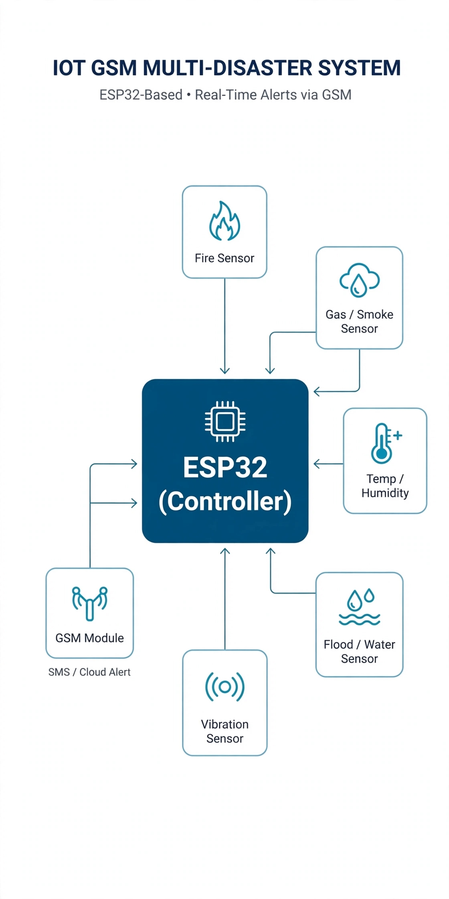

# IOT & GSM Based Multi-Disaster Detection System

Final Year Project - KNIT Sultanpur 2025-26

**Working:** ESP32 based system for Fire, Gas, Flood & Earthquake detection with Buzzer + GSM SMS + Blynk IoT Alert.

**Files:**
- Code: IOT_GSM_Multi_Disaster file
- Hardware Photo: IMG file (working prototype)

**Team:** Anshika, Shristy, Srishty, Atifa | Guide: Prof. H.V. Singh
